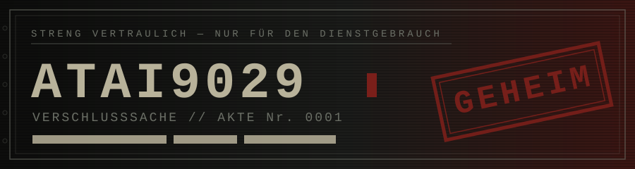
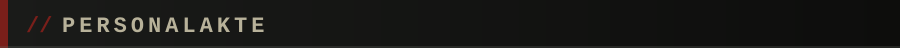
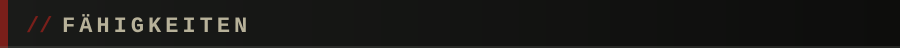
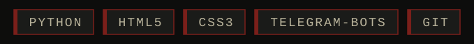
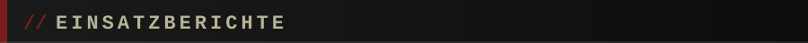
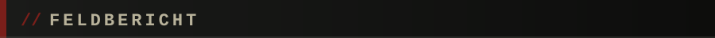
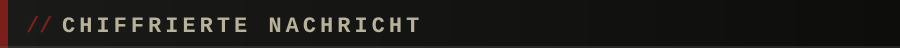
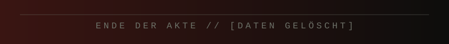

<div align="center">
  
</div>

<br>

```
╔══════════════════════════════════════════╗
║  AKTE: SMOKY NAGATO                      ║
║  STATUS: AKTIV                           ║
║  EINSTUFUNG: VERTRAULICH                 ║
║  ZUGRIFF: ▓▓▓▓▓▓▓▓░░ 80%                 ║
╚══════════════════════════════════════════╝
```



| FELD | DATEN |
|:--|:--|
| **Deckname** | Smoky Nagato |
| **Rolle** | Entwickler |
| **Standort** | `[ZENSIERT]` |
| **Spezialgebiet** | Python / Telegram-Bots / Web |
| **Schlaf** | `0%` |



<div align="center">
  
</div>



| OPERATION | SPRACHE | AKTE |
|:--|:--|:--|
| **ARMED-FORCES** | HTML | [Öffnen](https://github.com/Atai9029/ARMED-FORCES) |
| **ARMED-FORCES-UPDATE** | HTML | [Öffnen](https://github.com/Atai9029/ARMED-FORCES-UPDATE) |
| **tg-bots** | Python | [Öffnen](https://github.com/Atai9029/tg-bots) |
| **IT-125** | Python | [Öffnen](https://github.com/Atai9029/IT-125) |



```
> REPOSITORIEN ....... 8
> HAUPTSPRACHEN ...... PYTHON, HTML
> LETZTE OPERATION ... ARMED-FORCES-UPDATE
> STATUS ............. IM DIENST
```



```
WKH FRGH LV QHYHU ILQLVKHG
```

> *Шифр Цезаря, сдвиг 3. Расшифруй, если сможешь.*


